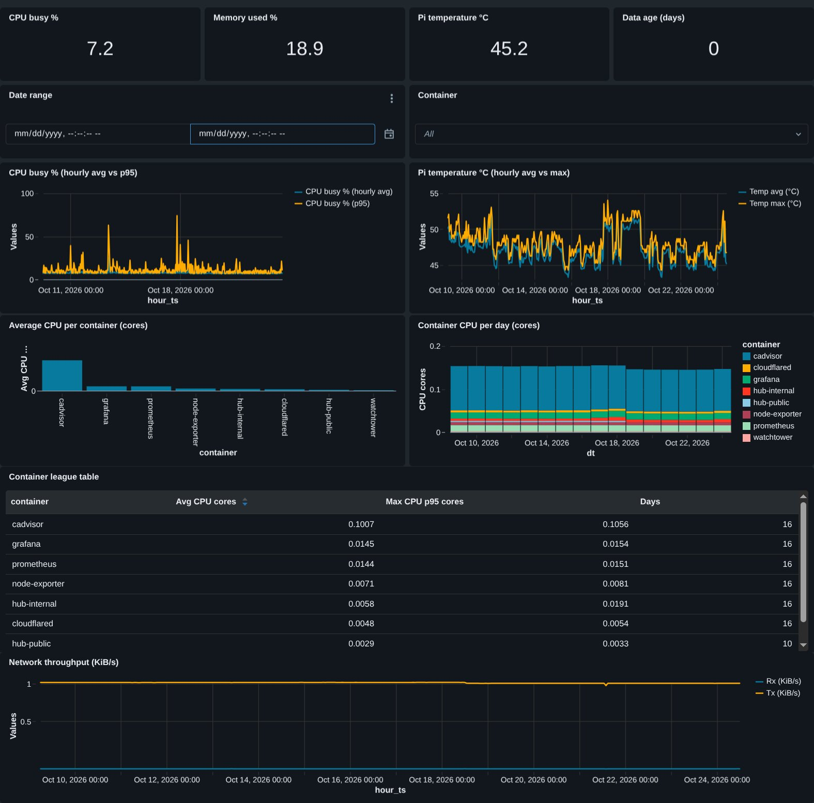
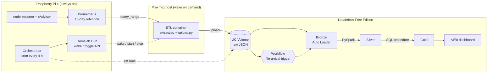
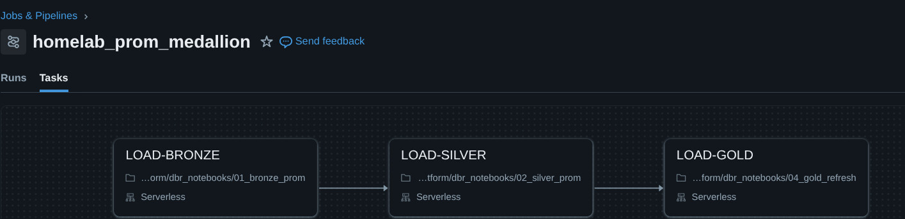

# homelab-data-platform

A bronze, silver and gold pipeline on **Databricks** and **PySpark**, fed by the metrics my own Raspberry Pi and Proxmox homelab produce. A dashboard sits on top, and a small scheduler wakes the hardware only when the data is stale.

I built it to get hands-on with Databricks and PySpark. I started with no experience in either, so the project is also a record of how I learned them. It is a homelab project: each run moves about 5 MB, so it shows patterns, not scale.



## Live walkthrough

An interactive walkthrough (architecture, code excerpts, the power-control sequence and the checks I ran) is published here: **https://hl-data.start3tech.com/**

> If the link is not available, my homelab might be down for maintenance. Please try again after some time. The same page is also in this repo at [`docs/report/index.html`](docs/report/index.html), and you can open it locally in any browser.

## Architecture



## How it works

| Layer | What happens | Where |
|---|---|---|
| Extract | 11 PromQL queries, last 15 days at 5-minute steps, one raw JSON file per metric per day. A `_COMPLETE` marker is written last. | [`lxc/extract.py`](lxc/extract.py) |
| Land | Files are uploaded to a Unity Catalog Volume with the Databricks SDK. The marker is written to the Volume as the final step. | [`lxc/upload.py`](lxc/upload.py) |
| Bronze | Auto Loader appends raw JSON to a Delta table with an explicit schema (labels as a map), source file and ingest time. | [`dbr_notebooks/01_bronze_prom.ipynb`](dbr_notebooks/01_bronze_prom.ipynb) |
| Silver | PySpark explodes the nested response, keeps ten labels, builds a stable series key, drops NaN and infinite values, and dedupes overlapping runs with a window function. A final assert fails the job on any duplicate. | [`dbr_notebooks/02_silver_prom.ipynb`](dbr_notebooks/02_silver_prom.ipynb) |
| Gold | A SQL stored procedure, `refresh_gold(from_date)`, runs two `MERGE` statements into an hourly host table and a daily per-container table. Safe to re-run. | [`03_gold_setup`](dbr_notebooks/03_gold_setup.ipynb), [`04_gold_refresh`](dbr_notebooks/04_gold_refresh.ipynb) |
| Orchestrate | A Databricks Workflow with three serverless tasks, started by a file-arrival trigger. | [`jobs/homelab_prom_medallion`](jobs/homelab_prom_medallion) |
| Serve | An AI/BI dashboard that reads gold only. | [`dashboards/`](dashboards) |
| Power control | A script on the Pi checks freshness, wakes Proxmox through the Homelab Hub, starts the ETL container, waits for the marker, then stops the container and the host. | [`pi/orchestrate.py`](pi/orchestrate.py) |



## Design decisions

- **Duplicates are expected, so silver dedupes.** Each run pulls the full 15 days. I wake the host several times in that window, so bronze holds overlapping data by design. Dedupe happens once, in silver.
- **A marker file marks a finished upload.** A run folder appears at the first uploaded file, long before the last. The Pi waits for `_COMPLETE` before it stops the container.
- **Free Edition uses a Volume as the landing zone.** Free Edition is serverless only and I could not confirm reading my own S3 bucket, so files go straight into a Volume. The ingest pattern is the same.
- **The scheduler is conservative.** It treats data as stale after 10 days (Prometheus keeps 15), makes one attempt per 24 hours, exits without touching anything if the Databricks API fails, never toggles the container twice, avoids the nightly backup window, and leaves the host on during Sundays.
- **Container memory shows zero.** The Pi kernel has no memory cgroup, so cAdvisor has nothing to read. The metric stays in the pipeline and will fill in once the kernel option is enabled.

## Checks I ran

| Layer | Check | Result |
|---|---|---|
| Bronze | One run, then two overlapping runs | 176 rows / 176 files, then 352 rows / 2 runs |
| Bronze | Stream re-run with no new files | 0 rows added |
| Silver | Rows before and after dedupe (2 runs) | 281,810 before, 140,690 after |
| Silver | Samples per series over 15 days | 4,366 each, no gaps |
| Gold | Procedure called twice, then a third run of files | 364 hourly and 122 container-day rows both times, then 365 hourly (not tripled) |
| Workflow | Files uploaded by the LXC | File-arrival trigger started the job on its own, all tasks green |
| Orchestration | Live cycle | About 3 minutes from wake to shutdown |

## Repository layout

```
dbr_notebooks/   Databricks notebooks (setup, bronze, silver, gold, validation)
dashboards/      Exported AI/BI dashboard (.lvdash.json)
jobs/            Exported Workflow definition (YAML)
lxc/             Extractor, uploader, run script and systemd unit for the ETL container
pi/              Orchestrator, cron example and env example for the Raspberry Pi
docs/            Report page and screenshots
```

## Setup outline

1. In Databricks, create the catalog `homelab` with schemas `landing`, `bronze`, `silver`, `gold` and the Volumes `landing.prom_raw` and `landing.checkpoints`. Run `03_gold_setup` once to create the gold tables and the procedure.
2. Create the Workflow from `jobs/homelab_prom_medallion` and add a file-arrival trigger on `/Volumes/homelab/landing/prom_raw/`. Replace `<you>` in the notebook paths with your workspace user.
3. On the ETL container, copy `lxc/` to `/opt/hl-etl/`, create a venv with `requests` and `databricks-sdk`, copy `lxc/.env.example` to `.env` and fill it in, then install `hl-etl.service` and enable it.
4. On the Pi, copy `pi/` to `~/hl-orch/`, copy `.env.example` to `.env`, run once with `DRY_RUN=1`, and add the cron line from `pi/crontab.example`.

## Secrets

Real values live in untracked `.env` files only. This repo contains `.env.example` files with variable names and placeholders. No tokens, addresses or credentials are committed.
